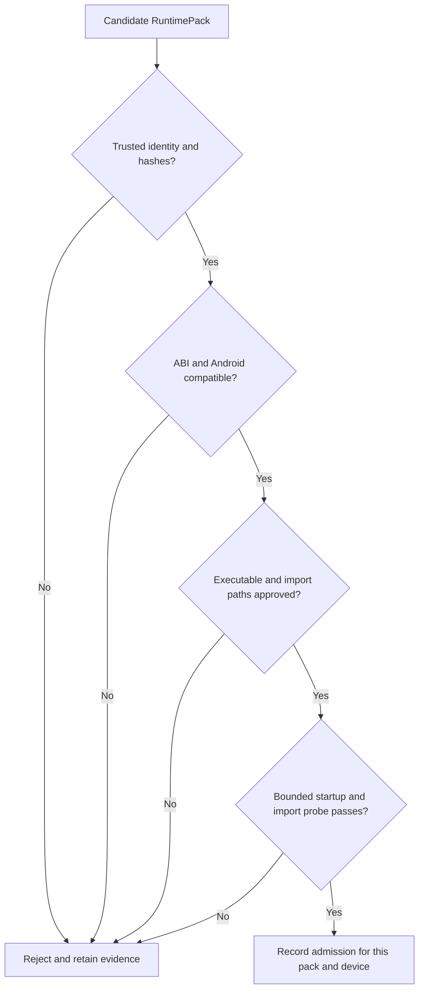

import AdmissionSimulator from '@site/src/components/AdmissionSimulator';

**Capability status: Planned.** The model below is documentation, not a runtime verifier. Existing launch validation and cancellation are building blocks, not completion of this contract.

## Proposed admission flow



The controlled probe is itself execution. Run it only after trust, integrity, compatibility, installation-path checks, and applicable execution authorization pass. Use NativeSupervisor with explicit limits and diagnostic capture.

<AdmissionSimulator />

## Admission checklist

| Check | Required evidence | Reject when |
| --- | --- | --- |
| Identity | Pack ID, version, trusted publisher, metadata trust policy | Unknown identity, missing trust anchor, inconsistent metadata |
| Integrity | Expected hashes from trusted metadata and measured inventory | Missing, added, replaced, or mismatched required files |
| ABI | Device ABI, Python build ABI, native extension ABI | Runtime or required extension is incompatible |
| Android | Minimum API, loader requirements, selected device/build | API or native loader requirements are unsupported |
| Location | Canonical executable path, installation provenance, controlled imports | Path escapes policy or Android does not permit execution |
| Probe | Request ID, timeout, exit/signal/stage, startup marker, required imports | Timeout, cancellation, missing marker, failed import, uncertain cleanup |

A locally computed hash does not establish publisher trust. Native wheels must match Android and the selected Python runtime; desktop Linux wheels are not automatically suitable.

## Android execution location

An absolute path or executable permission bit alone does not prove Android permits execution. Applications targeting Android 10 or later cannot directly execute binaries from writable app-home directories. Validate the actual packaging and installation strategy on the target device. The writable runtime-pack root in the current launch validator is not proof of executable admission.

Source: [Android execution restrictions](https://developer.android.com/about/versions/10/behavior-changes-10#execute-permission).

## Proposed evidence record

The schema is not frozen. Agree on bounded field sizes, serialization, and canonicalization before implementation.

```json
{
  "schemaVersion": 1,
  "status": "rejected",
  "packId": "example-pack",
  "packVersion": "candidate",
  "deviceAbi": "arm64-v8a",
  "androidApi": 35,
  "requestId": "example-request",
  "reason": "STARTUP_PROBE_NOT_VERIFIED"
}
```

A real record must also bind the trusted manifest digest, measured inventory, executable path, Python build identity, probe results, policy version, and application build revision. Invalidate admission after relevant pack, policy, application, or device changes. Never reuse a simulated result as evidence.

## Existing implementation evidence

| Building block | Evidence | Scope |
| --- | --- | --- |
| Launch validation | [EtRouteRuntime.kt](https://github.com/Nemack7713/ETroute/blob/65110be6e3e5c7ef449060821285f35dba58b987/android/src/main/java/org/nemack/universalfilelab/etroute/EtRouteRuntime.kt) | Canonical launch fields and session boundaries; not publisher verification |
| Cancellation | [Native supervisor](https://github.com/Nemack7713/ETroute/blob/65110be6e3e5c7ef449060821285f35dba58b987/native/src/native_supervisor.cpp) | Request cancellation and timeout handling; process groups are not a sandbox |
| Host checks and builds | [CI run](https://github.com/Nemack7713/ETroute/actions/runs/44827287835) | Native/JNI/Python host checks and APK compilation; not Python admission or device acceptance |
| Physical procedure | [Device gate script](https://github.com/Nemack7713/ETroute/blob/65110be6e3e5c7ef449060821285f35dba58b987/tools/run_physical_device_final_test.sh) | Procedure, not an executed result |

## Acceptance gate

Assign Device-verified only after an approved pack starts on the target phone, required imports pass, rejection cases fail closed, Stop and timeout terminate the controlled worker, diagnostics remain attributable, and cleanup waits for confirmed termination.
