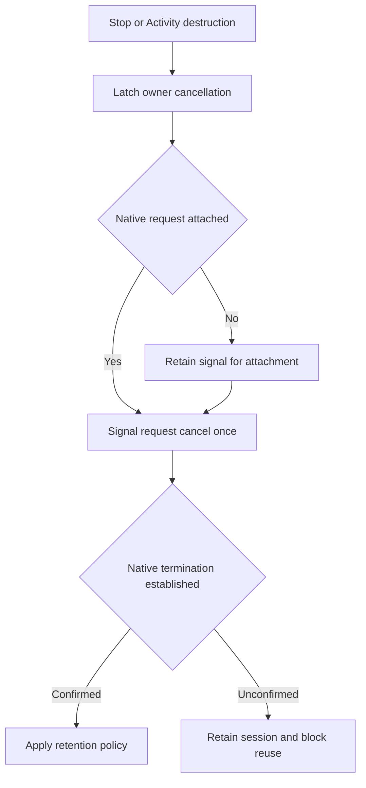

**Status: integration review candidate. Python execution remains unavailable.**

The review branch combines cancellation PR #6, the preflight/coordinator implementation
through PR #14 and documentation through PR #13. This is an ordinary integration branch;
no native-stack registration, automatic rebasing or main-branch merge is implied.

## Request-owned cancellation

NativeStopController is connected to the device-validator Activity and the existing
JniNativeSupervisor.Request.cancel signal. Stop requires neither a start capability nor
valid evidence. It never routes through a caller-supplied session ID. An active request
cannot be replaced until its completion has been reported. Late completion from an older
request cannot detach a newer one. Stop remains latched for the owned sequential stream.

Before attachment, Stop records intent without pretending a native child exists. Attachment
signals the actual request. After destruction, late attachment is cancelled and rejected.
Cancellation is a request, not proof of termination: native execution must return a result.
A thrown execution call or CLEANUP_UNCONFIRMED result retains state and blocks stream reuse.
Repeated Stop of an attached request signals once. There is no coroutine wrapper in this
integration, so no coroutine dependency or simulated coroutine cancellation was added.

## Lifecycle and cleanup policy

The validator continues its worker on ordinary background/onStop events. Activity destruction
closes the owner and signals cancellation. A new Activity does not automatically restart a
run. The worker must finish independently before termination can be assessed; destruction
alone is not confirmation. A future foreground-service/recovery policy remains separate.

Normal confirmed completion permits the existing ephemeral finalizer. Stopped, closed or
uncertain streams retain the session. Existing bounded screen diagnostics remain in place;
this is not a complete live streaming/disk-quota implementation. Uncertain termination
blocks a new suite in that Activity and prevents its finalizers from deleting execution files.
Across process death or Activity recreation, persistent recovery is still required.

## Validation scope

- JVM tests: pre-attachment Stop, repeated Stop, stale completion, uncertainty, late attachment
  after destruction, destruction during work, active-request replacement and multithreaded races.
- Native host tests: ABI, process supervision and cancellation regressions.
- Host JNI checks and Android compilation: cumulative CI; physical-device instrumentation
  remains a separate gate even when the instrumentation APK compiles.
- Documentation: existing model tests, lint and production build.

No tracked Python binary or RuntimePack archive was found in the integration inventory.
The system-command device smoke suite is a native execution check, not Python acceptance.
A genuine packaged runtime, Android platform adapter, fixed probe runner, independent
observations, bounded streaming and physical-device Python acceptance are still required.
