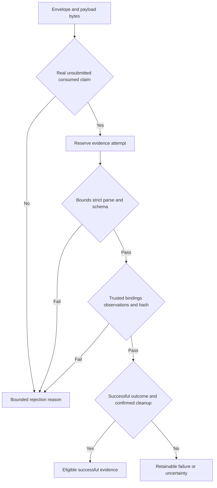

**Status: implementation candidate in [draft PR #12](https://github.com/Nemack7713/ETroute/pull/12).
No Python execution is enabled.**

Depends on the consumed-capability registry from [draft PR #11](https://github.com/Nemack7713/ETroute/pull/11)
and the [authorization contract](./probe-authorization.mdx). Draft PRs are not merged contracts.

## Validation pipeline

Authorization is consumed before execution, not here. The registry atomically reserves
one evidence attempt against the original consumed receipt by reference identity before
parsing. Failed, malformed and concurrent submissions cannot reopen that attempt.
A copied receipt or JSON identifier does not establish authority. Replay state remains
process-local and bounded; durable storage and a trusted coordinator are not implemented.

## Implemented candidate limits

| Layer | Limit or rule |
| --- | --- |
| Envelope | Nonempty, at most 16 KiB before decoding |
| Payload | At most the trusted claimed output budget, with registry ceiling 16 MiB |
| Decode | Strict UTF-8; malformed input rejected |
| Structure | Four object levels, sixteen fields per object, 256 UTF-16 units per key/string |
| JSON | Strict streaming reader; duplicate keys, arrays, comments and trailing documents rejected |
| Time | Cooperative 100 ms monotonic parse/hash budget; checked between bounded operations |
| Schema | Exact field sets/types/version; integer counters; lowercase SHA-256; valid UTC calendar timestamp |
| Authority | Real consumed claim, matching scope and trusted observations; no self-reported approval |

The time budget is not a hard interruption or a proven device latency bound.
The runtime implementation requires API 26+, matching preflight. Existing tests use
JUnit 4. Gson 2.11.0 supplies the strict reader; no reflective model deserialization is used.

## Semantic validation

Envelope bindings must match claim and observation: nonce, capability ID, inventory,
inspection/script/scope digests, app build, device binding, ABI/API and effective limits.
Timestamp must match the trusted observation as well as pass calendar validation;
clock recency policy belongs to the future coordinator.

Observed result, duration, retained/dropped output counts, exit code, signal, native stage,
termination and artifact disposition must match. Evidence is not trusted merely because
it claims those values. The future coordinator must obtain them independently.

SHA-256 covers exact supplied payload bytes. Reordering envelope fields cannot change
that hash. V1 requires a null payloadRef and opens no files. Payload byte count must match
the retained output counter and remain within the claimed cap. Dropped bytes do not prove
that generation or disk output was capped; streaming enforcement is a separate step.

## Successful evidence versus failure retention

Successful evidence requires completed result, exit zero, no signal, native stage zero,
duration within the claimed wall budget and confirmed termination with ephemeral artifacts
removed or absent. A completed result contradicting these conditions rejects.

Failed, cancelled, timed-out, not-started or unknown observations can remain valid failure
records. Cleanup uncertainty or retained artifacts sets retainSession=true. A budget overrun
may therefore be recorded as failure rather than erased. No cleanup is performed by parsing.
Rejected input returns a bounded reason code; later persistence must retain appropriate
bounded diagnostics and reconcile uncertain termination.

Validated means eligible for later storage. It does not mean persisted, signed, admitted
or authorized to run user scripts. The [proposed JSON Schema](pathname:///contracts/probe-evidence-v1.schema.json)
is a structural superset: the candidate additionally requires supplied payload bytes,
null file references and authoritative semantic checks. Its synthetic example is not
execution evidence and is not a successful validator fixture.

## Verification and remaining integration

The candidate defines twelve JVM tests for bounds-first rejection, malformed UTF-8,
duplicate keys, trailing input, depth/strings, unknown/missing fields, bad versions/types,
invalid dates, scope/observation mismatch, payload integrity, copied receipts, concurrent
submissions, deadline exhaustion and uncertain cleanup. CI status is recorded in PR #12;
test definitions alone are not passing results.

No trusted observation collector, native execution bridge, persistence journal, durable
replay handling or physical-device acceptance is provided. Scope/inventory canonicalization
remains a coordinator requirement. Passing this layer never flips a Python feature flag.
