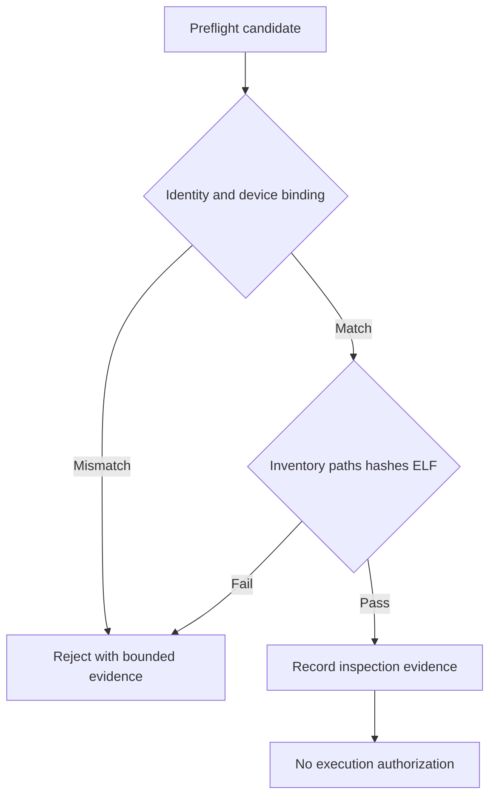
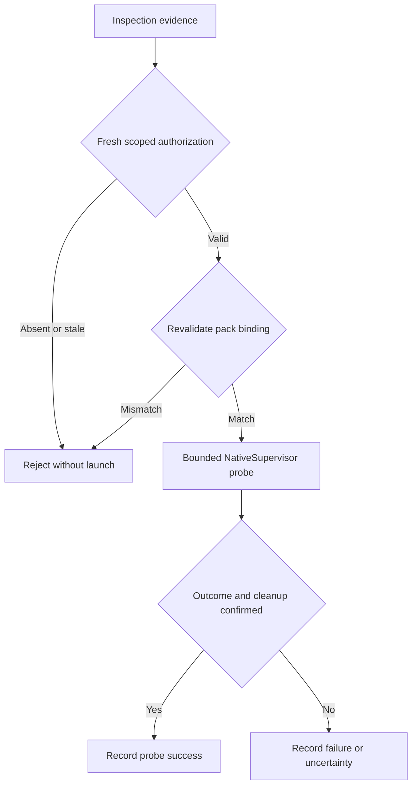

**Status: proposed contract; device-probe implementation and physical-device validation are pending.**

This contract separates read-only device inspection from a separately authorized execution probe.
Neither stage authorizes user scripts. No Chaquopy or PRoot fallback is part of this contract.

## Prerequisite and evidence

The Kotlin preflight candidate is [draft PR #8](https://github.com/Nemack7713/ETroute/pull/8),
source revision `a4a613a45ae6a08f7b7c20675ad2ebe8a22bae51`.
Its successful result is `READY_FOR_DEVICE_PROBE`, not runtime admission.
[CI evidence](https://github.com/Nemack7713/ETroute/actions/runs/44837097971)
covers unit tests and Android compilation; it does not establish physical-device execution.
The referenced PR is a dependency, not a claim that its changes have merged.

The v1 inspection API floor is API 26. This does not change the library's minSdk.
A supported device API alone does not prove runtime compatibility.
See [RuntimePack admission](./1-runtimepack-admission.mdx) for the larger admission flow.

## Stage 1: read-only device inspection



Re-run preflight against the actual device API, process ABI, app-owned native library
location and pack location. Check trusted pins, exact payload inventory, hashes,
canonical paths, symlink rejection, ELF architecture and inspection budgets.
Do not call `execve`, load pack libraries, import Python modules or invoke Python.
Reading an ELF header is inspection; starting a binary to ask its version is execution.

A passing inspection produces `inspection-passed`. Unknown checks, exhausted budgets,
I/O failures and mismatches reject explicitly. No fallback or activation occurs.

## Stage 2: controlled execution probe



This is a future execution stage, requiring an explicit authorization mechanism before
implementation can launch a probe. An evidence JSON boolean is never an authorization token.
Bind authorization to one request nonce, pack inventory digest, device/app identity,
fixed probe script and allowed imports, resource budgets and expiry. Consume it once.

Launch only the absolute validated executable through NativeSupervisor, with an explicit
environment and no child PATH lookup. The fixed probe may check startup, reported Python
identity and approved imports. Do not accept arbitrary user code or module names as probe input.
Recheck the pack binding immediately before launch. A mutable-file check-to-execution gap
remains an implementation concern; this document does not claim an atomic handoff.

Specify wall-clock timeout, resource limits, output byte limits and Stop cancellation
before launch. Record effective limits and any unsupported enforcement; required limits
must fail closed. Drain output while keeping retained diagnostics bounded.
A fresh process and process-group cleanup are not an Android security sandbox.

Probe success is evidence for a later admission decision. It grants no user-script launch
permission and does not replace the [Device Acceptance Suite](./5-device-acceptance-suite.mdx).

## Structured evidence envelope

The following is an illustrative inspection result, not an implemented wire schema or a
signed attestation. Placeholder values must be replaced with observed values.

```json
{
  "schemaVersion": 1,
  "stage": "device-inspection",
  "requestId": "<unique-request-id>",
  "nonce": "<fresh-request-nonce>",
  "sourceRevision": "a4a613a45ae6a08f7b7c20675ad2ebe8a22bae51",
  "appBuildIdentity": "<application-id-version-and-build-digest>",
  "pack": {
    "id": "<trusted-pack-id>",
    "version": "<pinned-version>",
    "inventorySha256": "<canonical-inventory-digest>",
    "expectedPythonIdentity": "<pinned-python-identity>",
    "observedPythonIdentity": null
  },
  "device": { "api": 35, "processAbi": "arm64-v8a" },
  "checks": {
    "identity": "pass",
    "hashes": "pass",
    "inventory": "pass",
    "apiAndAbi": "pass",
    "paths": "pass",
    "elf": "pass"
  },
  "result": "inspection-passed",
  "executionAttempted": false,
  "userScriptLaunchAuthorized": false,
  "timestamp": "<UTC-ISO-8601>",
  "diagnosticsRef": null,
  "attestation": { "kind": "unsigned" }
}
```

For execution evidence, additionally record the authorization reference and scope digest,
probe script digest, effective budgets, observed Python identity, native exit code, signal,
stage, timeout and cancellation flags, output truncation counters and cleanup confirmation.
Use explicit `not-run` or `unknown` values for checks that were not established.
Do not report a hash match as proof that Python started or an import succeeded.

Define inventory canonicalization, digest encoding, maximum envelope size, allowed result
values and schema validation before implementing persistence. Diagnostics references must
resolve only within the app-owned evidence directory. Never include credentials or tokens.
Signing requires a defined trust model, key custody and verification scheme; trusted pack
pins do not sign the probe result. Until then, label evidence unsigned.

## Cleanup and recovery

| Outcome | Required handling |
| --- | --- |
| Inspection rejected | Persist bounded reasons; remove inspection-owned temporary files |
| Probe stopped, timed out or failed | Confirm termination before deleting execution-owned temporary files |
| Cleanup unconfirmed | Retain diagnostics and necessary session state; flag uncertainty for recovery |
| Probe succeeded | Persist evidence, confirm cleanup, then remove ephemeral probe artifacts |
| App restarted | Revalidate evidence identity; never replay authorization or auto-launch |

An optional marker is an evidence reference only. Validate its schema, identity and digest
across process boundaries. It must not act as a reusable execution permission.

## Implementation gates

- Unit tests: API/ABI mismatch, tampering, stale binding, malformed envelopes, bounded
  diagnostics, missing authorization, replay rejection and cleanup uncertainty.
- Native integration tests: fixed-script scope, absolute executable, timeout, Stop,
  output limits, exit/signal mapping and process-group cleanup reporting.
- Physical-device evidence: startup and approved imports, followed separately by the
  broader acceptance suite covering lifecycle, restart and session recovery.

The next implementation decision is the one-use probe authorization interface and its
binding to NativeSupervisor. Inspection budgets, envelope schema and digest canonicalization
must be fixed alongside that interface before enabling execution.
