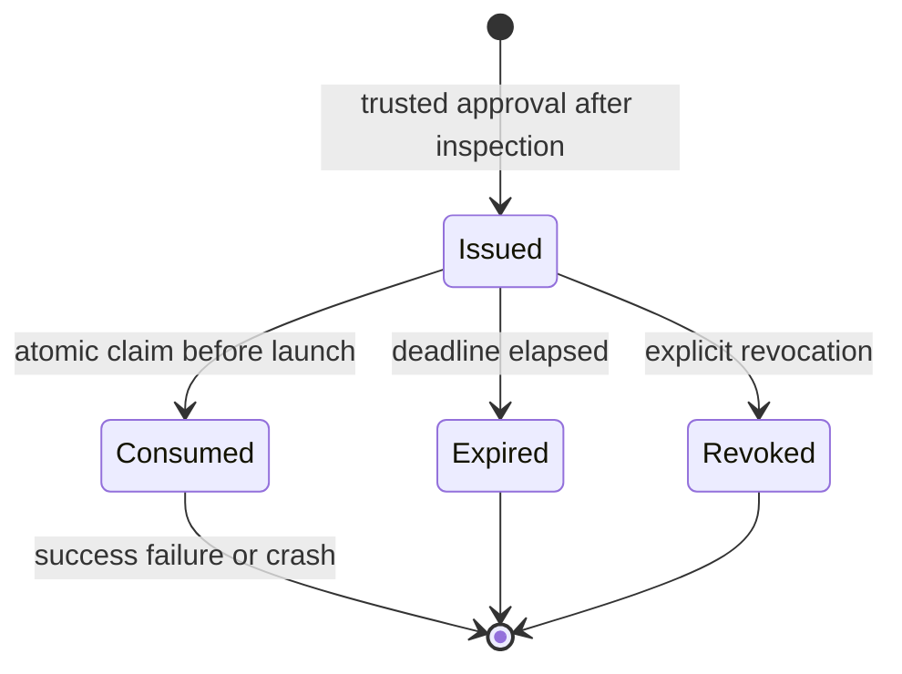
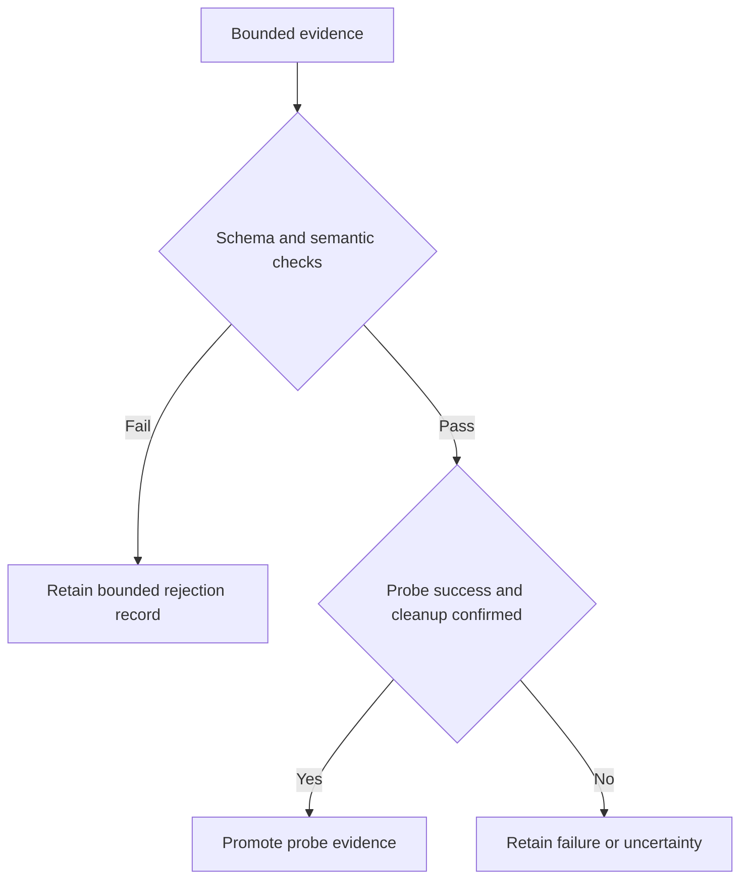

**Status: proposed interface and schema; no runtime authorization or execution implementation.**

Depends on the [two-stage device-probe contract](./device-probe-contract.mdx)
from [draft PR #9](https://github.com/Nemack7713/ETroute/pull/9).
This change launches nothing. A future authorized execution probe may start Python solely
for its fixed startup/import checks. It never authorizes arbitrary user scripts.
Chaquopy and fallback execution remain excluded.

## Authorization lifecycle

Consume authorization atomically **before** any execution attempt, not after evidence
acceptance. Concurrent claimers must have exactly one winner. Failure, cancellation,
invalid evidence or a crash never restores a consumed capability. A retry requires
fresh inspection binding and fresh authorization.

## Proposed Kotlin interface semantics

| Operation | Required behavior |
| --- | --- |
| Request approval | Available only after a passing, fresh device inspection; never grant implicitly |
| Issue capability | Trusted gate creates an opaque capability bound to one request and fixed scope |
| Claim capability | Atomically validate binding, expiry and state, then transition issued to consumed |
| Return claim | Return an internal execution permit to the fixed probe runner; never infer permission from JSON |
| Reject claim | Reject replay, expiry, revocation, stale inspection or any binding mismatch without launch |
| Recover after restart | Invalidate outstanding capabilities unless durable atomic consumption is implemented |

Scope includes request nonce, pack inventory digest, inspection evidence digest, app build,
device binding, absolute executable, fixed probe script digest, approved imports, effective
resource/output limits and expiry. Device API and ABI alone are not a unique device identity.
Capability identifiers in evidence are references, not bearer secrets. Do not persist secrets
in diagnostic logs or envelopes. JWT-like syntax or a counter alone does not prevent replay.

For an initial process-local implementation, all capabilities and permits die with the
issuer process. Disable issuance in other app processes or use one authoritative service;
independent per-process registries cannot provide a global one-use guarantee.
Persisted evidence must never reconstruct a permit.

## Proposed machine-readable evidence schema

- [JSON Schema, draft 2020-12](pathname:///contracts/probe-evidence-v1.schema.json)
- [Synthetic example envelope](pathname:///contracts/probe-evidence-v1.example.json)

The schema rejects unknown fields, missing fields, invalid digest encoding, unsupported
versions and unconsumed authorization states. It permits explicit failure and cleanup
uncertainty so rejected attempts remain auditable. The example demonstrates structure
only: its digests are synthetic and are not proof of a runtime probe.

Schema validity is necessary but insufficient. Implement these acceptance checks separately:

| Check | Requirement |
| --- | --- |
| Input limits | Bound envelope bytes before parsing, parser depth, string sizes and referenced payload bytes |
| Authority | Match the authoritative consumed claim and scope; never trust self-reported consumed state |
| Replay | Deduplicate every attempted request/capability, including failed evidence; enforce with atomic storage |
| Binding | Match inspected pack, app/device identity, fixed script, limits and fresh authorization |
| Output and duration | Compare observed values with trusted configured bounds, not caller-provided bounds |
| Payload | Resolve only under the app-owned evidence root, reject traversal/symlinks and hash the actual bounded bytes |
| Result consistency | Check exit/signal/native stage, result, timeout and cleanup together |
| Promotion | Promote only a successful probe with confirmed termination and required cleanup |

Schema validation does not authenticate unsigned evidence or prove cleanup happened.
Require a date-time format checker with an installed date-time implementation when validating
timestamps; the UTC pattern checks syntax only, not calendar validity. Define clock policy and
monotonic expiry behavior before enabling capabilities.

Hash exact stored payload bytes, not an envelope containing its own hash. A null payload
reference requires the caller to supply the matching bounded bytes through the trusted
validation interface; otherwise reject promotion. Inventory/scope canonicalization and
whether any payload may be absent remain implementation decisions, not implied by this schema.

## Evidence outcomes and cleanup

A structurally valid failure record may be retained without becoming successful admission
evidence. Never require cleanup success merely to record a failure. If termination is
unconfirmed, retain necessary session state and diagnostics for recovery; defer deletion
of execution-owned files. Retain consumed-state tombstones or invalidate the entire issuer
epoch so cleanup cannot reopen replay. Neither evidence acceptance nor a marker authorizes
user-script execution.

## Implementation and verification gates

Before Kotlin implementation, fix the authorization authority, restart policy, numeric
budgets, inventory/scope digest encoding, parser and persistence transaction boundaries.
The schema's integer ceilings are encoding limits, not approved runtime budgets.

Required runtime tests include concurrent claims, second use, expiry, revocation, crash
and restart, stale binding, forged consumed flags, oversized envelopes, malformed JSON,
invalid timestamps, payload mismatch/path escape, inconsistent results and cleanup uncertainty.
These runtime tests are requirements, not results of the documentation build.

Keep diagrams and schema under review with the implementation. No physical-device test,
Python startup, native permit integration or cryptographic attestation is established here.
