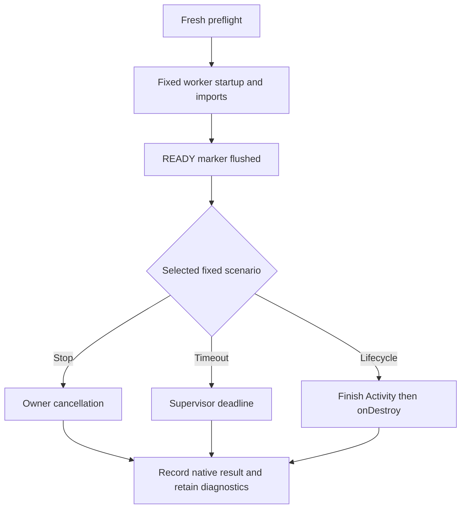

**Status: fixed on-device test harness; interruption results pending user/device execution.**

The user-provided startup screenshot from the earlier candidate reports CPython 3.14.4,
native stage OK, exit zero, no signal/timeout, 172 ms, OpenSSL 3.0.19, SQLite 3.50.4,
empty stderr and no truncation. This is one successful startup/import observation, not
a required duration or proof of interruption acceptance.

## Fixed worker synchronization

The worker supports only --probe and --probe-wait with an absolute payload root. The wait
variant prints a readiness marker after the normal imports and sleeps for a fixed 30 seconds.
It does not accept arbitrary delays, scripts, modules or commands. Owner Stop waits for
readiness instead of guessing a 50 ms window. Timeout is a fixed three-second NativeSupervisor
deadline. Other scenarios have a ten-second safety deadline. Polling reads are byte bounded.

The worker change produces a new hash inventory and acceptance pack identity. It uses the
same pinned official CPython archive, but requires fresh preflight and startup confirmation;
the prior worker's complete binary identity is not reused as admission evidence.

## Phone workflow

Install the side-by-side ETroute Python Acceptance APK (application ID ending .acceptance).
It does not replace the earlier preflight/manual-probe apps or start work automatically.

1. Tap RUN STOP / TIMEOUT SUITE. It runs the cases below and retains a summary plus detail.
2. Save the displayed summary, then tap RUN LIFECYCLE CHECK (CLOSES APP).
3. After the app closes, reopen it and tap SHOW LATEST REPORT. No probe auto-restarts.

| Case | Real scenario | Required result |
| --- | --- | --- |
| ST01 | Stop requested three times before native attachment | CANCELLED, no child status, zero spawn error, one cancel signal; NOT_STARTED |
| ST02 | Owner Stop after readiness | CANCELLED, not timed out, readiness seen, one cancel signal, termination confirmed |
| ST03 | Three Stop requests after readiness | Same confirmed cancellation, exactly one native cancellation signal |
| ST04 | Fixed wait exceeds three-second supervisor deadline | TIMEOUT_KILL, timedOut=true, readiness seen, zero owner signals, termination confirmed |
| ST05 | Real Activity finish after readiness | onDestroy observed, confirmed cancellation, no silent restart; retained report after reopening |
| ST07 | Normal fixed startup/import probe | Native success, marker present, no cancellation/truncation, confirmed completion |

Pre-attachment cancellation is not a running-child termination test. Confirmation relies on
the native result contract, including its process-group cleanup status; it is not an independent
kernel audit of arbitrary escaped descendants. A failed readiness, limit, cancellation or
confirmation check cannot be promoted to a passing case. Stop is always owner/request bound.

## Retention and incomplete gates

All scenarios retain files for review, including normal confirmed completion. Cleanup may be
allowed after confirmation but is not asserted as performed. Reports distinguish NOT_STARTED,
CONFIRMED and UNCERTAIN. Each stream is capped at 8 KiB and each case report at 20,000 bytes;
the atomically replaced latest summary is capped at 100,000 bytes. At most twelve diagnostic
sessions are reserved per installation. A persisted in-flight/uncertainty marker blocks retries
when termination cannot be confirmed. Reopening an Activity only reads the report.

ST06 uncertainty remains a deterministic JVM policy test, labeled NOT_RUN_ON_DEVICE rather
than manufactured by killing a process. A kill can have confirmed termination. Real uncertain
cleanup injection and persistent recovery are separate gates. ST08 production evidence hand-off
is NOT_CONNECTED; this harness does not invent a new envelope or claim semantic acceptance.
General script execution remains disabled and no runtime admission is promoted.

Five new JVM rule tests cover classification of pre-attachment cancellation, readiness and
idempotence, timeout distinction, actual lifecycle observation and normal completion. Existing
uncertainty tests remain. Two executable Android instrumentation tests exercise the suite and
real Activity finish, but CI compilation is not physical-device execution.
