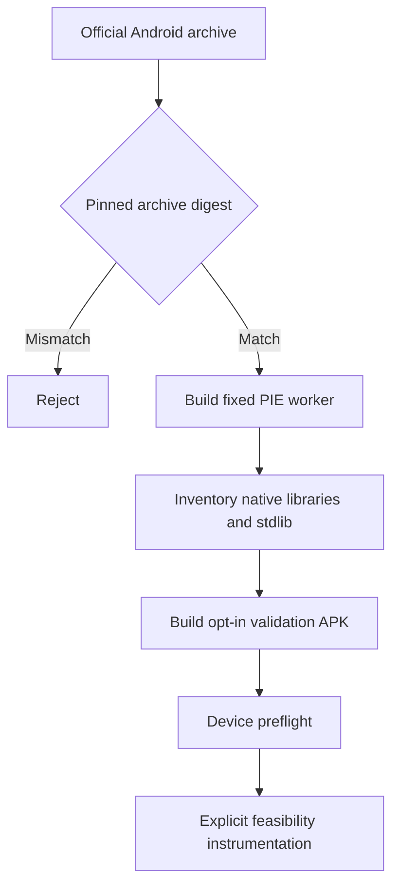

**Status: build candidate; Android execution and admission remain unverified.**

The official CPython 3.14.4 arm64 Android archive is pinned by SHA-256:
`410fff96f47d818136f91f79c8f83202e1364aeaab2022d00fa70e53007ebde1`.
[Release checksums](https://www.python.org/downloads/release/python-3144/)
and [Android integration documentation](https://docs.python.org/3.14/using/android.html)
are the upstream references. This is an initial pinned feasibility version, not a policy
to ship this version indefinitely. Archive hashing is not Sigstore signature verification.

## Candidate construction



The worker embeds libpython inside a separately executed process. NativeSupervisor remains
the absolute-exec boundary; CPython is not embedded in the Android UI process. No Chaquopy,
PRoot, shell-based interpreter lookup, on-device pip or arbitrary Python arguments are used.
The only worker command is a compiled-in startup/import probe. Its test imports json, math,
hashlib, ssl and sqlite3; third-party packages are not included.

The builder pins NDK 27.3.13750724 and targets arm64/API 26 for the worker. It emits a PIE
ELF with the Android linker and origin-relative library lookup, native and payload hashes,
compiler command and readelf report. The upstream runtime was built upstream, not rebuilt
from source by this workflow. Its archive carries its own dependency files and Python license;
complete upstream provenance/signature and license review remain admission requirements.
Pinned inputs make rebuilding auditable; bit-identical APK reproduction is not claimed.

## APK and device gates

The separate runtimepack-validator module is included only with etrouteRuntimePack=true
and runtimepackBuildDir pointing at generated output. Native libraries are extracted from
the APK into Android's nativeLibraryDir so the packaged worker has an app-owned executable
location. The stdlib is staged into app-private data and checked against packaged trusted
inventory. Preflight requires API 26 through 35 and arm64; other devices reject.

The ordinary APK screen only installs payload and runs read-only preflight. It does not
launch Python. Separately invoked Android instrumentation may run the fixed worker through
ETroute with timeout, CPU/open-file/file-size limits and request-owned Stop. That is an
explicit feasibility test, not the production coordinator's authorization path. It retains
session diagnostics and does not promote admission or enable general scripts.

A successful build, ELF check or APK-content check cannot establish that Android loads the
worker, that imports succeed, or that native cancellation and cleanup work on-device.
Instrumentation APK compilation is not a device test result. The workflow uploads both APKs
and the candidate so those checks can be performed on an authorized API 35 arm64 device.

## Reproduce

Download the exact archive linked from the release page, then run:

```bash
python3 tools/runtimepack/build_candidate.py --archive /absolute/path/python-3.14.4-aarch64-linux-android.tar.gz --output /absolute/path/new-candidate
```

ANDROID_HOME must contain NDK 27.3.13750724 on Linux. Output must not already exist.
The inspect-only option verifies/extracts the archive without compiling a worker.
Normal builds remain unchanged unless the opt-in property is supplied.

## Remaining work

Device startup/import execution, failure-path evidence, production coordinator integration,
full native-limit binding, Stop/timeout/restart acceptance, bounded streaming and recovery
remain separate gates. Preflight success means READY_FOR_DEVICE_PROBE, not full admission.
