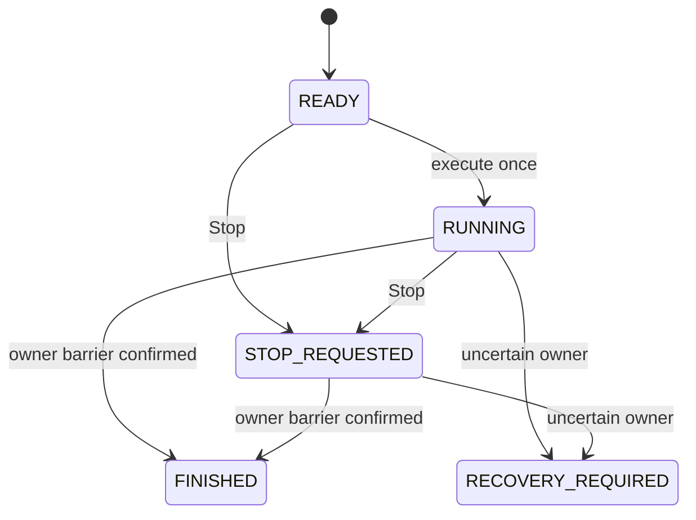

The v10 API 35 results supplied by the user pass all eight sequential cases and the separate reopen-retention check. That baseline validates the fixed probe and simulated receipt-loss policy. Actual native uncertainty remains untested. The earlier registry rejection did not recur and its cause remains unknown.

## Ordered integration slices

1. Define a typed fixed-probe result and request-owned handle.
2. Connect the handle to the existing coordinator, admission checks, NativeSupervisor and owner finalization.
3. Compile the validator consumer against the generated AAR and compare its packaged native libraries with the APK.
4. Run JVM race, Stop, replay and observation tests; compile instrumentation; then obtain device confirmation.
5. Connect the actual ETuMAX application only after its repository and backend contract are inspected.

The connected repository search did not identify the user's ETuMAX repository. The validator is an AAR consumer, not evidence that the ETuMAX application is integrated. The retained v10 session is not reused, cleared or treated as launch authorization.

## Typed contract

`EtRouteFixedProbeBackend` is composed by trusted host code with APK-pinned RuntimePack metadata. UI-facing requests expose no arbitrary source, executable, arguments or environment. `FixedProbeResult` separates validation, successful probe, native status, nullable exit/signal, termination, session correlation, relative evidence reference and completion barrier. Diagnostic text is display-only and never parsed to authorize or classify a result.

`schemaVersion=1`, `generalScriptExecutionEnabled=false`, `actualNativeUncertaintyTested=false` and `attestation=unsigned` are explicit. Schema acceptance does not imply probe success, a signed attestation or general execution permission.

## Stop and completion

`stop()` directly signals the request-local owner, independently of capability expiry and evidence. Repeated Stop is idempotent. It is not queued behind execution. Stop does not publish a terminal result, free a running reservation or claim native termination. Late Stop cannot affect a newer handle. Execute is single-use; a Stop before execute prevents approval and native dispatch.

A backend rejects another request while one is reserved. An uncertain owner keeps that backend blocked; the existing persistent uncertainty gate also remains enforced by the underlying owner. Creating a new backend does not clear that gate. No automatic retry, restart, cleanup or authorization refund is added.

## Observation and lifecycle

`state` is a read-only `StateFlow`. Reading or recollecting it does not launch anything. `execute` is deliberately blocking and must run off Main. This slice does not add a coroutine execution adapter: a host must explicitly wire lifecycle Stop to the owned handle. Wrapping execute in `withContext(IO)` does not itself provide prompt native cancellation.

`awaitCompletion` only observes an already-owned request. Cancelling that wait signals Stop and rethrows cancellation. If execution has not been invoked, the handle remains Stop-requested until execute finalizes its no-start outcome; no execution is automatically scheduled. The host must keep ownership/finalization separate from UI collection and must not claim that cancelling a waiter means the native child ended.

Configuration changes may reconnect observers; application process death still needs explicit session reconciliation. No full streaming or recovery implementation is claimed here.

## Validation and packaging

Pure JVM tests use real thread barriers for Stop-before-start, repeated active Stop, late Stop/replay, uncertain owner and cancelled observation. The readiness barrier in the fake is not physical JNI evidence. The opt-in validator's ST08 completion now calls the typed handle, evaluates typed fields and displays existing bounded diagnostics. Other interruption/lifecycle cases remain regression checks of the existing owner.

The consumer uses `android-debug.aar` as a file dependency and explicitly declares Gson and coroutines because a bare AAR does not carry Maven transitive-dependency metadata. CI verifies public API classes and hashes arm64 JNI libraries against the APK. Neither the AAR nor an APK download authorizes caller-selected RuntimePacks. Candidate payload/assets and trusted pins are still required at host composition.

Instrumented APK compilation is separate from execution. New device acceptance must confirm the typed ST08 result and repeat the terminal receipt-loss/reopen procedure in the separate v11 application. Prior v10 files remain untouched. No merge or default enablement is part of this slice.
